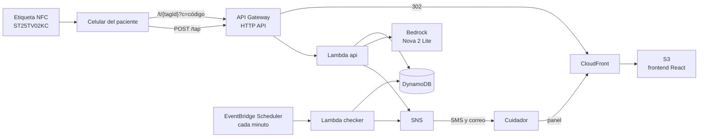

# Toma

**Un toque para ti, tranquilidad para tu familia.**

Toma ayuda a adultos mayores con enfermedades crónicas a tomar sus medicinas a tiempo. Cada caja
lleva una etiqueta NFC: el paciente acerca su celular, sin instalar ninguna app, y la dosis queda
registrada. Si una dosis se olvida o se intenta tomar dos veces, el familiar recibe un aviso. Una
foto de la receta se convierte en horarios automáticamente.

Proyecto del equipo **sudo rm-rf /** para AWS Student Day 2026.

## Demo en vivo

| Qué | Link |
|---|---|
| Consola de demo (reiniciar, simular etiqueta clonada) | https://d1crnboupf611m.cloudfront.net/demo |
| Panel del cuidador | https://d1crnboupf611m.cloudfront.net/p/demo |
| Página de toque (lo que abre la etiqueta) | https://dfw205xdab.execute-api.us-east-2.amazonaws.com/t/toma-demo-1 |
| API | https://dfw205xdab.execute-api.us-east-2.amazonaws.com |

Flujo sugerido: abrir `/demo` → **Reiniciar** → a los 5 s Losartán se marca como olvidada y se
avisa al familiar → tocar la etiqueta de Metformina → "¡Listo!" → tocar otra vez → aviso de dosis
doble → subir una foto de receta desde el panel.

## El problema

En México, 17 % de los adultos vive con diabetes tipo 2 y 29 % con hipertensión. De las personas
diagnosticadas con diabetes, 9 de cada 10 están en tratamiento, pero solo 1 de cada 3 tiene la
glucosa controlada, y estudios en México reportan baja adherencia en 30 a 70 % de los pacientes
(Ensanut Continua 2021-2024; Rev. méd. Chile, 2022). Olvidar una dosis, duplicarla o que el
familiar no se entere son problemas cotidianos.

## Qué hace

- **Registro con un toque.** La etiqueta NFC abre una página que registra la dosis y muestra la
  siguiente toma, el avance del día y la constancia de la semana.
- **Dosis doble.** Un segundo toque en el mismo horario avisa al paciente y al familiar.
- **Dosis olvidada.** Si termina la tolerancia del horario sin toque, el familiar recibe un aviso
  por SMS y correo.
- **Receta con IA.** Amazon Bedrock lee la foto de la receta y propone medicinas y horarios, que el
  familiar revisa antes de guardar.
- **Anti-clonación.** El chip ST25TV02KC agrega un código único a la URL en cada toque. El backend
  rechaza códigos repetidos, así que una URL copiada o una etiqueta clonada no pueden fingir una
  dosis.

## Arquitectura



| Servicio | Uso |
|---|---|
| Amazon API Gateway (HTTP API) | Endpoints públicos con throttling y CORS; recibe la URL de las etiquetas |
| AWS Lambda (Python 3.13, arm64) | `api`: toques, pacientes, medicinas, panel, receta y demo. `checker`: dosis olvidadas. `web`: redirige las URLs de las etiquetas al frontend |
| Amazon DynamoDB | Tabla única para pacientes, medicinas, etiquetas, dosis y avisos |
| Amazon EventBridge Scheduler | Ejecuta el revisor de dosis olvidadas cada minuto |
| Amazon SNS | Avisos al familiar por SMS y correo |
| Amazon Bedrock (Amazon Nova 2 Lite) | Lectura de recetas a partir de una foto |
| Amazon S3 + Amazon CloudFront | Hosting del frontend con bucket privado (OAC) y ruteo SPA |
| AWS SAM / AWS CloudFormation | Infraestructura como código |
| AWS IAM, Amazon CloudWatch | Permisos mínimos por función y logs |

Todo es serverless y corre en `us-east-2`; sin uso, el costo es prácticamente cero.

Más detalle: [docs/design.md](docs/design.md), [docs/requirements.md](docs/requirements.md),
[docs/API.md](docs/API.md) y [docs/UI_BRIEF.md](docs/UI_BRIEF.md).

## Repositorio

```
backend/    Plantilla SAM, código de las Lambdas y pruebas
frontend/   App web (Vite + React + TypeScript + Tailwind)
infra/      Hosting del frontend (S3 + CloudFront)
docs/       Requisitos, diseño, contrato de la API y brief de UI
```

## Cómo desplegar

Requisitos: AWS CLI v2, SAM CLI, Python 3.13, Node.js 20+ y un perfil de AWS.

**Backend**

```bash
cd backend
sam build
sam deploy --profile <perfil> \
  --parameter-overrides AlertEmail=<correo> FrontendUrl=<url de CloudFront>
```

**Frontend**

```bash
aws cloudformation deploy --template-file infra/frontend.yaml --stack-name toma-frontend --profile <perfil>
cd frontend
cp .env.example .env
npm ci && npm run build
aws s3 sync dist s3://<bucket> --delete --profile <perfil>
```

**Pruebas**

```bash
cd backend
pip install -r requirements-dev.txt
pytest
```

### Modelo de datos

Tabla única de DynamoDB con `pk` / `sk`:

| pk | sk | Elemento |
|---|---|---|
| `PATIENT#<pid>` | `PROFILE` | Paciente y cuidador |
| `PATIENT#<pid>` | `MED#<mid>` | Medicina, horarios, tolerancia y etiqueta |
| `PATIENT#<pid>` | `DOSE#<fecha>#<mid>#<HH:MM>` | Dosis tomada; una por horario gracias a una escritura condicional |
| `PATIENT#<pid>` | `ALERT#<fecha>#<mid>#<HH:MM>` | Aviso de dosis olvidada o doble |
| `TAG#<tagId>` | `TAG` | Vínculo de la etiqueta, esquema de código y último código visto |

### Código de toque

Cada etiqueta declara su esquema. `hex` es un contador público, usado por las etiquetas
simuladas. `st25` decodifica el código único del ST25TV02KC; ese decodificador es propietario,
no forma parte de este repositorio y solo se incluye al desplegar desde la máquina de su autor
(`backend/src/tap_codes_private.py`, ignorado por git).

## Limitaciones y siguientes pasos

- El panel del cuidador no tiene inicio de sesión todavía; el siguiente paso es Amazon Cognito.
- Los SMS están en modo de prueba de AWS: solo llegan a números verificados y con un tope de gasto
  mensual.
- Activar el código de toque `st25` en todas las etiquetas físicas y rechazar toques sin código.
- Recordatorios con voz para el paciente (Amazon Polly).

## Equipo

- Ian Navarro
- Diego Sanchez
- Javier Diaz
- Alonso Astudillo
